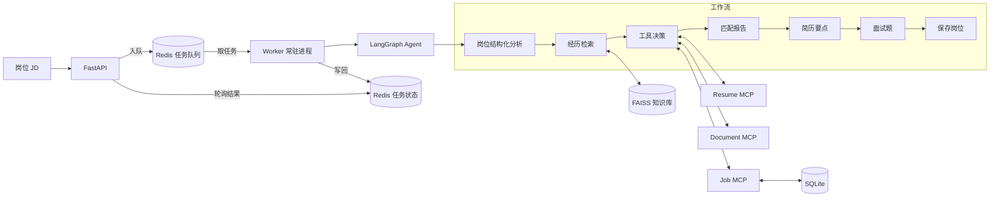

# CareerPilot MCP Agent

CareerPilot 是一个面向 AI 应用开发实习求职场景的本地 Agent。输入岗位 JD 后，系统会分析岗位要求，从候选人知识库检索可核验经历，生成匹配报告、定制简历要点和面试题，并通过 MCP 工具记录岗位或生成文档。

项目重点不是“再做一个聊天机器人”，而是展示如何把大模型应用拆分为可编排、可追踪、可评测的工作流和标准化工具。

## 项目亮点

- 使用 LangGraph 编排岗位分析、RAG 检索、MCP 工具路由、报告生成、简历改写、面试题生成与岗位保存。
- 自建 3 个本地 stdio MCP Server，提供简历查询、岗位管理和 Markdown 文档生成能力。
- 使用 DashScope Embedding 和 FAISS 构建个人材料知识库，检索结果保留来源与距离分数。
- 在高相关结果不足时触发查询改写和补充检索，避免只根据固定返回条数判断召回质量。
- 使用 Pydantic 约束岗位分析、简历要点与面试题结构，模型失败时自动重试。
- 使用 Loguru 记录节点、模型、MCP 工具、RAG 来源和耗时。
- 提供 10 个真实岗位样例和 10 个变体组成的离线评测集。

## 当前状态

| 能力 | 状态 | 说明 |
| --- | :---: | --- |
| JD 结构化分析 | 已完成 | 提取岗位、公司、级别、要求与检索关键词 |
| FAISS 经历检索 | 已完成 | 返回内容、来源和距离分数 |
| 查询改写与补充检索 | 已完成 | 高相关结果不足时触发 |
| 3 个 MCP Server | 已完成 | 当前使用本地 stdio 传输 |
| 简历要点和面试题 | 已完成 | Pydantic 结构化输出 |
| SQLite 岗位记录 | 已完成 | 支持保存、筛选和状态更新 |
| 20 例离线评测 | 已完成 | 默认关闭真实 MCP 写操作 |
| 离线测试与 CI | 已完成 | 不需要 API Key，覆盖数据库与文档服务 |
| Streamlit 界面 | 计划中 | 当前使用命令行入口 |
| Docker 部署 | 已完成 | Dockerfile + docker-compose.yml，一条命令启动 |
| 异步任务与 Redis | 已完成 | 提交立刻返回 task_id，worker 后台执行，带幂等去重与限流 |

## 系统架构



API 与 Worker 是同镜像的两个进程：API 只负责收请求和派发，重活全部由 Worker 消费队列执行，互不阻塞。

MCP Server 当前均由客户端以 stdio 子进程启动。项目没有将它们描述为远程服务；如需跨主机部署，可以在后续版本中迁移到 Streamable HTTP。

## 工作流

```text
岗位 JD
  -> 提取岗位要求和关键词
  -> 第一轮向量检索
  -> 必要时改写查询并补充检索
  -> Agent 按需调用 MCP 工具
  -> 生成带来源的匹配报告
  -> 生成 1-3 条简历要点
  -> 生成 5 道面试题和回答要点
  -> 通过 Job MCP 保存岗位
```

## 目录结构

```text
careerpilot/
├── agent/                 # LangGraph 状态、节点、Schema、模型和 MCP 适配
├── knowledge/
│   ├── docs/              # 可公开的脱敏示例资料
│   ├── build_index.py     # 构建 FAISS 索引
│   └── retrieve.py        # 检索、查询改写和补充检索
├── tasks/                 # 异步任务层
│   ├── store.py           # 队列 / 状态 / 幂等 / 限流，Redis 操作全在这里
│   ├── worker.py          # 常驻消费者进程
│   └── runner.py          # 执行一次分析的共享入口，API 与 worker 复用
├── mcp_servers/           # resume / job / document 三个 MCP Server
├── eval/                  # 20 例评测集和已有结果
├── examples/              # 可直接运行的示例 JD
├── scripts/               # 图结构和 MCP 演示脚本
├── data/                  # 本地 SQLite 数据，数据库文件不提交
├── output/                # 生成文档，不提交
├── run.py                 # 命令行入口
├── mcp.json               # MCP Server 配置
├── requirements.txt       # API 运行期依赖，Docker 镜像只装这一个
└── requirements-ui.txt    # 界面层依赖（Streamlit），刻意不进 API 镜像
```

## 快速开始

### 方式一：Docker 一键启动（推荐，不用配 Python 环境）

确保已安装 [Docker Desktop](https://www.docker.com/products/docker-desktop/) 并处于运行状态。

```powershell
Copy-Item .env.example .env      # 填入 LLM_API_KEY 和 DASHSCOPE_API_KEY
docker compose up -d             # 首次会构建镜像并自动建立向量索引
docker compose logs -f           # 查看日志，出现 health 即就绪
```

服务起来后访问 <http://localhost:8000/docs>。启动流程由 `docker-entrypoint.sh` 控制：检测到 `knowledge/index/` 中没有索引时会自动构建，已存在则跳过——索引存在数据卷里，不会每次重复烧 embedding 的费用。

常用命令：

```powershell
docker compose down          # 停止（数据卷保留，岗位记录和索引都还在）
docker compose ps            # 查看运行状态与健康检查
docker compose logs -f api   # 只看服务日志
```

换了新的候选资料后需要重建索引：

```powershell
# 把 docker-compose.yml 里的 FORCE_REBUILD_INDEX 改成 "1"，然后
docker compose up -d --force-recreate api
```

> 说明：`.env` 已写进 `.dockerignore`，密钥不会进入镜像层；容器以非 root 用户运行；SQLite、输出文档、日志和索引分别存放在四个具名数据卷里。

### 方式二：本地 Python 环境

#### 1. 创建环境

建议使用 Python 3.10 或更高版本。

```powershell
git clone https://github.com/your-name/careerpilot-mcp-agent.git
Set-Location careerpilot-mcp-agent

python -m venv .venv
.\.venv\Scripts\Activate.ps1
python -m pip install --upgrade pip
python -m pip install -r requirements.txt
```

### 2. 配置模型

```powershell
Copy-Item .env.example .env
```

编辑 `.env`：

```dotenv
LLM_MODEL=qwen-plus
LLM_BASE_URL=https://dashscope.aliyuncs.com/compatible-mode/v1
LLM_API_KEY=your_key
DASHSCOPE_API_KEY=your_key
EMBEDDING_MODEL=text-embedding-v3
```

`.env` 已被 Git 忽略。不要把真实 API Key 写入 README、示例文件或提交历史。

如需把测试数据写到临时位置，也可以设置 `CAREERPILOT_DB_PATH` 和 `CAREERPILOT_OUTPUT_DIR`；未设置时分别使用 `data/jobs.db` 和 `output/`。

### 3. 准备候选人资料

`knowledge/docs/` 中包含用于演示的脱敏资料。正式使用时，可以将个人材料放进 `knowledge/docs/private/`，或自行调整加载目录。私人目录默认不会被 Git 提交。

### 4. 构建向量索引

```powershell
python -m knowledge.build_index
```

索引保存在 `knowledge/index/`，可以根据文档重新生成，因此默认不提交。

### 5. 运行完整示例

```powershell
python run.py --jd-file examples/sample_jd.txt
```

也可以直接输入 JD：

```powershell
python run.py --jd "招聘 AI 应用开发实习生，要求熟悉 Python、RAG、LangGraph 和 MCP"
```

运行后可查看：

- 终端中的匹配报告、简历要点和面试题；
- `logs/` 中的节点、模型、工具和检索轨迹；
- `data/jobs.db` 中保存的岗位记录；
- Agent 调用 Document MCP 后写入 `output/` 的 Markdown 文档。

## 异步任务与 Redis

一次分析要跑 50~120 秒，远超网关与浏览器常见的 30~60 秒超时。所以 `POST /analyze` 是异步的：立刻回一个 `task_id`，由后台 worker 慢慢跑，客户端用 `task_id` 轮询结果。

```powershell
# 1. 提交，毫秒级拿到回执
$r = Invoke-RestMethod -Uri http://localhost:8000/analyze -Method Post `
     -ContentType "application/json" -Body '{"jd":"招聘 AI 应用开发实习生，要求 Python 与 RAG 经验"}'
# 2. 轮询结果
Invoke-RestMethod -Uri "http://localhost:8000/tasks/$($r.task_id)"
```

> Windows 的 `curl` 其实是 `Invoke-WebRequest` 的别名，`curl -I xxx` 会被解析成 `-InFile` 而卡住要你输 URL。要么用 `curl.exe`，要么直接用上面这种 PowerShell 写法。

| 接口 | 行为 |
| --- | --- |
| `POST /analyze` | 202 + `task_id`；命中幂等时返回 `reused=true` 并复用已有任务 |
| `GET /tasks/{task_id}` | 返回 `pending / running / done / failed`，完成后带完整结果 |
| `POST /analyze/sync` | 同步执行，直接返回完整结果（本地调试与降级路径） |

### Redis 在这里的四种角色

| 角色 | 数据结构 | 解决什么 |
| --- | --- | --- |
| 任务队列 | Stream + 消费组 | 削峰与异步化；未 ACK 的任务可被其他 worker 认领重做 |
| 状态与结果 | Hash + TTL 24h | 轮询取结果；必须设 TTL，否则内存会无限增长 |
| 幂等去重 | `SET NX EX` | 同一份 JD 重复提交直接复用旧任务，不重复烧模型调用 |
| 并发限流 | `INCR` + 过期 | 保护上游模型配额，避免队列被瞬间撑爆 |

**为什么用 Stream 而不是 List**：`BRPOP` 一旦把任务取出来，Redis 里就再没有这条记录了，worker 崩溃任务就永久丢失。Stream 的 `XACK` 让已投递但未确认的消息留在 PEL 里，用 `XAUTOCLAIM` 可以转移给别的 worker 重做——这正是"任务丢了怎么办"的答案。

**为什么不做热点缓存**：这是 QPS 极低的重计算服务，缓存命中率趋近于 0，问一句"命中率多少"就穿帮。Redis 在这里的价值是削峰、异步、幂等、限流，不是加速读取。

**为什么幂等是正确性要求而不是优化**：一次分析要调 5~7 次大模型（花钱），而且有副作用——会通过 MCP 把岗位记录写进 SQLite。不去重的话，用户手抖点两次就会多一条重复记录。

### Redis 不可用时会自动降级

`POST /analyze` 捕获到 Redis 异常后，直接同步执行一次并返回 **200 + 完整结果**，响应头带 `X-Analysis-Mode: sync-fallback`：

```
HTTP/1.1 200 OK
x-analysis-mode: sync-fallback
```

降级不是另写一套实现，而是同一个 `run_analysis()` 换个入口。这样"降级路径"永远和"正常路径"保持同样的正确性，不会出现"平时好好的、降级时结果不一样"这种最难查的 bug。

## MCP 工具

| Server | 工具 | 用途 |
| --- | --- | --- |
| Resume MCP | `get_resume` | 获取脱敏候选人资料 |
| Resume MCP | `search_projects` | 按技术关键词查询项目 |
| Job MCP | `save_job` | 保存岗位和 JD |
| Job MCP | `list_jobs` | 按状态列出岗位 |
| Job MCP | `update_status` | 更新投递状态 |
| Job MCP | `get_job` | 按 id 查询单个岗位 |
| Job MCP | `list_jobs_from_company` | 按公司名查询岗位 |
| Document MCP | `generate_resume_md` | 生成 Markdown 简历要点 |
| Document MCP | `generate_interview_prep` | 生成面试准备文档 |

验证工具发现：

```powershell
python -m agent.mcp_tools
```

## 评测

查看 20 个评测用例，不调用模型：

```powershell
python -m eval.test_cases --list
```

运行一个低成本冒烟用例：

```powershell
python -m eval.test_cases --limit 1 --output eval/smoke_results.json
```

运行完整评测：

```powershell
python -m eval.test_cases --output eval/results.json
```

默认评测会关闭 MCP 工具，避免写入岗位数据库或生成文档。需要验证完整 MCP 链路时显式添加：

```powershell
python -m eval.test_cases --limit 1 --with-tools --output eval/mcp_smoke_results.json
```

### 最近一次端到端评测结果（2026-10-17）

完整结果见 [`eval/results_2026-10-17.json`](eval/results_2026-10-17.json)：真实调用模型，默认关闭 MCP 写操作。

| 指标 | 20 例 | 含义 |
| --- | :---: | --- |
| 格式通过 | 19/20 | 输出是否符合 Pydantic Schema |
| 关键词覆盖 | 19/20 | JD 要求的关键技能是否被覆盖 |
| 引用存在 | 19/20 | 报告是否标注了来源文件 |
| 引用真实性 | 19/20 | 标注的来源里是否真有这段内容 |
| 明显幻觉风险 | 1/20 | 越低越好 |
| 运行异常 | 1/20 | 链路未跑完的用例数 |

20 例总耗时 **19.7 分钟**，单条平均 59 秒（34s ~ 128s）。

**唯一失败的 `real-09` 与生成质量无关**：它在第一步就撞上 `[SSL: UNEXPECTED_EOF_WHILE_READING]`——上游 TLS 连接被意外掐断，重试 3 次都是同一个网络故障。它耗时 51 秒、`error` 字段为空、报告文本为空，正是"链路没跑完"而非"跑完了但内容不对"的特征。

这一轮是把知识库从 10 个片段扩充到 29 个之后重跑的，**产出质量没有下降**，说明检索库的扩充是安全的。

#### 三轮演进

| | 10-15 | 10-16 | 10-17 |
| --- | :---: | :---: | :---: |
| 通过率 | 17/20 | 20/20 | 19/20 |
| 运行异常 | 3 例（全 `ReadTimeout`） | 0 例 | 1 例（SSL 连接中断） |
| 总耗时 | 54.3 分钟 | 21.8 分钟 | 19.7 分钟 |

10-16 那轮的两处改动（至今保留）：

1. **读超时从"全局 60 秒"改成"分节点 60 / 90 / 120 / 150 / 180 秒"**。一次分析要打 5~7 次模型请求，超时限制的是**单次请求**；共用同一阈值时，短节点白等、长节点（`report` 实测 37 秒）被误杀。
2. **消除最后一轮 agent 空转**。`agent_node` 原本没有 system 指令，模型不知道自己该干什么，就在末尾写一段几百字总结——而这段总结没有任何消费者。现在轮次达上限直接跳过该次调用，并注入指令要求"信息足够时只输出 finish"。实测该步从 **58.3 秒降到 7.6 秒**。

---

### 检索质量评测 Recall@k（2026-10-17 新增）

端到端评测只能证明"最终产出能用"，证明不了"检索这一环牢不牢"。所以另建了一套检索指标。

```powershell
python -m eval.recall                 # 三种策略对比
python -m eval.recall --no-agentic    # 只跑基础检索，不调模型
```

**标注集** [`eval/retrieval_golden.json`](eval/retrieval_golden.json)：8 条真实岗位（均附来源 URL），人工标注"这份 JD 应该召回哪些片段"。其中 2 条是**低匹配对照组**（Java 技术栈的 Agent 岗、纯数据分析岗）——对照组存在的意义是验证指标有区分度，否则每个岗位都高召回，指标就是自欺。

| 指标 | 基础检索（k=4） |
| --- | :---: |
| Recall@1 | 0.143 |
| Recall@2 | 0.304 |
| **Recall@4** | **0.464** |
| Precision@4 | 0.656 |
| MRR | 0.875 |
| 高匹配岗位 Recall@4 | 0.508 |
| 低匹配岗位 Recall@4 | 0.333 |

**为什么知识库必须先扩到 29 个片段**：最初只有 10 个片段，`k=4` 等于取走全库 40%，Recall 会虚高且改了策略也看不出差异。扩到 29 个之后 `k=4` 只占 14%，指标才有区分度。

#### 这一套指标挖出的三个问题（比数字本身更有价值）

1. **"查询改写"功能从来没有被触发过。** 默认参数 `max_distance=1.02` 过于宽松，8 条岗位第一轮全部被判为"高相关 ≥2 条"，改写分支一次都没进去——agentic 与 plain 的结果完全相同。它是一个写了但从未生效的功能。
2. **距离分数的绝对值不能用来判断相关性。** 各岗位第一轮 top-4 的分数都落在 0.61~0.93，但 Recall 从 0.14 到 0.67 天差地别。不同查询的 L2 距离分布不同，绝对值没有可比性，所以 `max_distance` 这个阈值设计从根上就有问题。
3. **强制改写证明：功能有用，但必须条件触发。** 把 `min_hits` 设成 99 逼它改写后，平均 Recall@4 从 0.464 升到 0.506、Precision@4 从 0.656 升到 0.688。但逐条看规律是：**原本差的（0.14/0.33）全部上升，原本好的（0.57/0.67）反而下降**。改写只在第一轮确实不行时才该触发。

下一步计划用"召回片段命中了多少 JD 核心技能词"替代分数阈值来判断是否改写——它可计算、不依赖绝对值，且与项目已有的关键词覆盖评测是同一套思路。

这些指标检查结构、关键词和来源一致性，不等同于人工评价的回答质量。模型配置、Prompt、Schema 或知识库变更后应重新运行评测。下一步会增加人工标注相关片段、Recall@k、重复运行稳定性、延迟和调用成本。

## 离线测试与 CI

数据库、文档生成和 MCP 返回值规范化测试不需要模型 API Key：

```powershell
python -m unittest discover -s tests -v
```

`.github/workflows/ci.yml` 会在推送到 `main` 或创建 Pull Request 时自动安装依赖、运行离线测试并编译项目源码。需要真实模型的评测不会在公共 CI 中自动执行，避免泄露密钥和产生调用费用。

## 可观测性和容错

- 节点级：开始、完成、异常和耗时。
- 模型级：调用次数、重试次数和耗时。
- MCP 级：工具名、参数摘要、成功或失败状态。
- RAG 级：查询、来源、距离分数和内容摘要。
- MCP 工具发现失败时，工作流可降级到无工具模式；最终消息会如实说明岗位未保存。
- 分层超时：按节点输出长度给不同的读超时（JD 分析 60s、Agent 决策 90s、简历要点 120s、面试题 150s、匹配报告 180s）。一次分析要打 5~7 次模型请求，而超时限制的是**单次请求**；所有节点共用同一阈值时，要么误杀长文本节点，要么让短节点白白久等。
- 重试策略：区分「上游故障（429/超时/5xx）」与「输出不合规」，前者完整指数退避加抖动，后者只短等快速重试；客户端层关闭重试，避免与业务层相乘成 3×3=9 次请求。
- 避免 agent 收尾空转：工具轮次用完后不再回 agent。经典 ReAct 循环里模型最后一次被调用时要"收尾"，会再生成一段几百字的自然语言总结（实测 21~58 秒、外加一份 token），而本项目交付的是结构化字段，这段总结没有任何消费者。现在改为轮次达上限就直接进生成阶段，同时给 agent 注入 system 指令，要求"信息足够时只输出 finish"。

## 隐私与安全

- 只提交脱敏示例资料，不提交真实简历、手机号或私人课程记录。
- 只加载自己构建和信任的 FAISS 索引。当前 LangChain 加载路径允许反序列化本地索引，不应接收陌生人提供的索引文件。
- 如果 API Key 曾被提交，即使随后删除文件，也必须立即撤销并重新生成密钥。
- 生成文件和岗位数据库默认仅保存在本地。

## 已知限制

- 当前没有 Web 界面，主要通过命令行演示。
- MCP Server 使用本地 stdio，不是远程服务。
- Resume MCP 使用脱敏演示资料，正式使用需要替换为个人资料读取逻辑。
- 评测规模较小，且默认不启用真实 MCP 工具。
- 相似度阈值与知识库、Embedding 模型相关，迁移数据后应重新校准。

## Roadmap

- [ ] Streamlit 端到端演示界面
- [x] 离线单元测试与 GitHub Actions
- [ ] 混合检索和可配置重排
- [ ] 评测延迟、成本和多次运行稳定性
- [x] Docker Compose 本地启动
- [x] 只打包运行期依赖，界面层依赖已拆到 `requirements-ui.txt`，不再进 API 镜像
- [x] Redis 异步任务队列（Stream + 消费组）、幂等去重、限流、Redis 不可用自动降级
- [ ] worker 心跳与任务级进度上报（当前只能发现"进程没了"，发现不了"卡死"）
- [ ] 可选 Streamable HTTP MCP 部署
- [ ] 简历和面试材料 PDF 导出

## 面试讲解

项目设计取舍和常见追问见 [`docs/INTERVIEW_GUIDE.md`](docs/INTERVIEW_GUIDE.md)。
