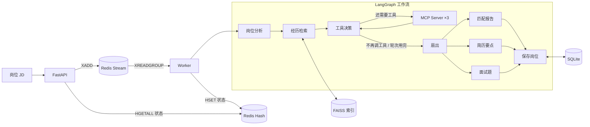

# CareerPilot MCP Agent

输入一段岗位 JD，输出结构化匹配报告、定制简历要点和面试题，并通过 MCP 工具把岗位记录写入 SQLite。

FastAPI 提供 HTTP 接口，Redis Stream 做异步任务队列（含幂等与限流），LangGraph 编排分析流程，FAISS 做本地向量检索，3 个 stdio MCP Server 提供工具能力。

## 功能

- **JD 结构化分析**：提取岗位、公司、级别、要求与检索关键词
- **经历检索**：向量检索返回内容、来源文件与距离分数
- **工具路由**：Agent 按需调用简历查询 / 岗位管理 / 文档生成三类工具，最多 3 轮
- **材料生成**：匹配报告、1~3 条简历要点、5 道面试题，均带 `evidence_source`
- **岗位记录**：写入 SQLite，支持按状态筛选与更新
- **网页界面**：填 JD → 轮询进度 → 分块查看报告、简历要点与面试题（`ui/`，Streamlit）

## 快速开始

方式一，Docker（需要 Docker Desktop）：

```powershell
Copy-Item .env.example .env      # 填 LLM_API_KEY 与 DASHSCOPE_API_KEY
docker compose up -d
docker compose logs -f           # 出现 health 即就绪
```

服务起在 <http://localhost:8000/docs>。首次启动时 `docker-entrypoint.sh` 会检测 `knowledge/index/`，没有索引就自动构建，已有则跳过。

方式二，本地 Python：

```powershell
python -m venv .venv
.\.venv\Scripts\Activate.ps1
python -m pip install -r requirements.txt
Copy-Item .env.example .env      # 同上，填 Key
python -m knowledge.build_index  # 构建向量索引
python run.py --jd-file examples/sample_jd.txt
```

方式三，网页界面（需要先启动 API）：

```powershell
python -m pip install -r requirements-ui.txt
python -m streamlit run ui/app.py
```

界面默认连 `http://127.0.0.1:8000`，可用 `CAREERPILOT_API_URL` 覆盖。

## 架构



api 与 worker 用同一个镜像、不同启动命令。api 只收请求和派发任务，分析全部由 worker 执行。

## 接口

| 接口 | 行为 |
| --- | --- |
| `POST /analyze` | 202 + `task_id`；命中幂等时返回 `reused=true` 并复用已有任务 |
| `GET /tasks/{task_id}` | 返回 `pending / running / done / failed`，完成后带完整结果 |
| `POST /analyze/sync` | 同步执行并直接返回结果，用于调试与降级 |
| `GET /health` | 探活，不检查 Redis |

状态码：`429` 触发限流，`404` 任务不存在或已过期（结果保留 24 小时），`502` 上游失败，`503` 任务存储不可用。

```powershell
$body = @{ jd = "招聘 AI 应用开发实习生，要求 Python 与 RAG 经验" } | ConvertTo-Json
$r = Invoke-RestMethod -Uri http://localhost:8000/analyze -Method Post `
     -ContentType "application/json; charset=utf-8" `
     -Body ([Text.Encoding]::UTF8.GetBytes($body))
Invoke-RestMethod -Uri "http://localhost:8000/tasks/$($r.task_id)"
```

> Windows PowerShell 5.1 把字符串 body 按 ANSI 发送，中文会变成 `?`，必须传 UTF-8 字节（上面写法）。

## 任务队列

- **队列**：Redis Stream + 消费组，任务处理完显式 `XACK`
- **故障回收**：未确认的消息留在 PEL，闲置超过 2 分钟的任务由其他 worker 用 `XAUTOCLAIM` 认领重做
- **幂等**：JD 的 SHA-256 指纹 + `SET NX EX`，24 小时有效
- **限流**：入口每分钟 20 次，命中幂等不消耗配额
- **降级**：Redis 不可用时同步执行，响应头带 `X-Analysis-Mode: sync-fallback`
- **退出**：SIGTERM 只置退出标志，当前任务 ACK 后进程才退出

一次分析要跑 8~120 秒（`deepseek-flash` 关闭思考模式后 20 例平均 8.8 秒；早期模型下平均 59 秒），仍可能超过网关和浏览器常见的 30~60 秒超时，所以走异步：接口毫秒级返回 `task_id`，客户端轮询结果。

## MCP 工具

| Server | 工具 | 用途 |
| --- | --- | --- |
| Resume | `get_resume` | 获取脱敏候选人资料 |
| Resume | `search_projects` | 按技术关键词查询项目 |
| Job | `save_job` | 保存岗位与 JD |
| Job | `list_jobs` | 按状态列出岗位 |
| Job | `update_status` | 更新投递状态 |
| Job | `get_job` | 按 id 查询单个岗位 |
| Job | `list_jobs_from_company` | 按公司名查询岗位 |
| Document | `generate_resume_md` | 生成 Markdown 简历要点 |
| Document | `generate_interview_prep` | 生成面试准备文档 |

工具发现失败时工作流降级为空工具模式，仍能产出基于检索的结果；此时最终消息会说明岗位未保存。

## 评测

**端到端（20 例，`eval/results_2026-11-03.json`，当前代码 + `deepseek-flash`）**

| 指标 | 结果 |
| --- | --- |
| 格式通过（Pydantic） | 20/20 |
| 关键词覆盖 | 20/20 |
| 引用存在（标注了来源文件） | 20/20 |
| 引用真实（来源出现在本轮检索结果中） | 20/20 |
| 明显幻觉风险 | 0/20 |
| 运行异常 | 0/20 |

总耗时 175.4 秒，单条平均 8.8 秒（7.2~11.4 秒），无环境级重试。

这轮全绿说明**结构性回归通过**：schema、引用标注、异常率都没退化。它不衡量内容质量，因此不适合用来比较模型或提示词的优劣——见下面的「已知限制」。

历史轮次（17/20 → 20/20 → 19/20 → 20/20）与每轮改动见 [docs/EVOLUTION.md](docs/EVOLUTION.md)。

**检索（8 条标注 JD，k=4，`eval/recall_results.json`，2026-11-03 重跑）**

| 指标 | 基础检索 |
| --- | --- |
| Recall@1 | 0.143 |
| Recall@2 | 0.304 |
| Recall@4 | 0.464 |
| Precision@4 | 0.656 |
| MRR | 0.875 |
| 高匹配岗位 Recall@4 | 0.508 |
| 低匹配岗位 Recall@4 | 0.333 |

标注集含 2 条低匹配对照岗位，用于验证指标有区分度。

这组指标暴露出三个问题：

1. **查询改写从未触发**：默认 `max_distance=1.02` 过松，8 条岗位第一轮全部被判为"高相关 ≥2 条"，改写分支一次都没进入，agentic 与 plain 结果完全相同。
2. **距离分数的绝对值不可用**：各岗位 top-4 分数都在 0.61~0.93，但 Recall 从 0.14 到 0.67，因为不同查询的 L2 距离分布不同。
3. **强制改写（`min_hits=99`）的收益不稳定**：10-17 那轮 Recall@4 从 0.464 升到 0.506、Precision 从 0.656 升到 0.688；11-03 重跑则是 0.464 / 0.656——**与 plain 持平**。原因是改写用的 query 由模型生成（`temperature=0.3`），每次不同，收益落在运行噪声里。所以不能拿单次结果证明"改写有效"。

## 目录结构

```text
careerpilot/
├── agent/                 # LangGraph 状态、节点、Schema、模型与 MCP 适配
├── api/                   # FastAPI 入口与接口契约
├── tasks/                 # 队列、worker、共享执行入口
├── knowledge/             # 索引构建与检索（docs/ 为脱敏示例资料）
├── mcp_servers/           # resume / job / document 三个 MCP Server
├── eval/                  # 20 例评测集、检索标注集与结果
├── scripts/               # 图结构、MCP、分数分布等调试脚本
├── ui/                    # Streamlit 界面（通过 HTTP 访问 API）
├── tests/                 # 离线单元测试
├── docs/                  # 迭代记录
├── run.py                 # 命令行入口
└── mcp.json               # MCP Server 配置
```

## 测试

```powershell
python -m unittest discover -s tests -t . -v   # 124 例离线单测（含 Redis 层，需本地 6379）
python -m compileall -q agent api tasks knowledge mcp_servers eval ui
```

`.github/workflows/ci.yml` 在推送与 PR 时执行上面两步（CI 自带 redis service），不调用模型、不需要 Key。需要真实模型的评测手动运行：

```powershell
python -m eval.test_cases --output eval/results.json
python -m eval.recall
```

## 已知限制

- 界面是单机 Streamlit，不含登录与多租户
- MCP Server 是本地 stdio 子进程，不是远程服务
- 评测规模小，默认不启用真实 MCP 写操作
- 评测指标已饱和（四项均 20/20）：用于**回归检测**而非质量评分；负例（简历无匹配岗位时会不会编）、内容级引用校验尚未覆盖
- 相似度阈值与知识库、Embedding 模型相关，换数据后需要重新校准
- 幂等只在提交入口生效，`save_job` 没有唯一约束：worker 在写库后、ACK 前崩溃时，重做会插入重复记录

## 隐私

仓库只包含脱敏示例资料，不含真实简历、手机号与私人记录。`.env` 在 `.gitignore` 与 `.dockerignore` 中，不会进入提交或镜像。
