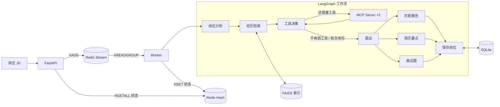

# CareerPilot MCP Agent

输入一段岗位 JD，输出结构化匹配报告、定制简历要点和面试题；岗位记录由原生服务写入 SQLite，
简历与文档能力通过 MCP 工具提供。

FastAPI 提供 HTTP 接口，Redis Stream 做异步任务队列（含幂等与限流），LangGraph 编排分析流程，FAISS 做本地向量检索，2 个 stdio MCP Server（简历、文档）提供工具能力，
岗位读写走原生服务层（`services/jobs.py`）。

## 功能

- **JD 结构化分析**：提取岗位、公司、级别、要求、偏好与检索关键词
- **经历检索**：按语料规模自适应（直读 / 向量 / 混合），返回内容、来源文件与距离分数
- **工具路由**：Agent 按需调用简历查询 / 文档生成两类 MCP 工具 + 本地检索工具，最多 3 轮
- **材料生成**：匹配报告、1~3 条简历要点、5 道面试题，均带 `evidence_source`
- **定制简历**：结构化 `tailored_resume`（一句话定位 / 概述 / 技能分组 / 3~8 条要点），通过真实性校验后渲染 Markdown
- **真实性校验**：来源、项目名、数字、逐字片段、主张强度、对应要求逐条核对，不合规条目直接丢弃
- **岗位工作台**：SQLite 记录、状态筛选与更新、多岗位技能聚类
- **岗位发现**：官方 ATS / 公开 API 抓取、证据覆盖率打分、候选池导入岗位库
- **资料与事实台账**：资料版本管理、索引重建、易过期数字自动 lint
- **网页界面**：填 JD → 轮询进度 → 分块查看报告、简历要点与面试题（`ui/`，Streamlit）

## 快速开始

方式一，Docker（需要 Docker Desktop）：

```powershell
Copy-Item .env.example .env      # 填 LLM_API_KEY 与 DASHSCOPE_API_KEY
docker compose up -d
docker compose logs -f           # 出现 health 即就绪
```

服务起在 <http://localhost:8000/docs>。首次启动时 `docker-entrypoint.sh` 会检测 `knowledge/index/`，没有索引就自动构建，已有则跳过。

方式二，本地 Python：

```powershell
python -m venv .venv
.\.venv\Scripts\Activate.ps1
python -m pip install -r requirements.txt
Copy-Item .env.example .env      # 同上，填 Key
python -m knowledge.build_index  # 构建向量索引
python run.py --jd-file examples/sample_jd.txt
```

方式三，网页界面（需要先启动 API）：

```powershell
python -m pip install -r requirements-ui.txt
python -m streamlit run ui/app.py
```

界面默认连 `http://127.0.0.1:8000`，可用 `CAREERPILOT_API_URL` 覆盖。

## 架构



api 与 worker 用同一个镜像、不同启动命令。api 只收请求和派发任务，分析全部由 worker 执行。

## 接口

| 接口 | 行为 |
| --- | --- |
| `POST /analyze` | 202 + `task_id`；命中幂等时返回 `reused=true` 并复用已有任务 |
| `GET /tasks/{task_id}` | 返回 `pending / running / done / failed`，完成后带完整结果 |
| `POST /analyze/sync` | 同步执行并直接返回结果，用于调试与降级 |
| `GET /health` | 探活，不检查 Redis |
| `GET/POST /jobs`、`GET/PATCH/DELETE /jobs/{id}` | 岗位工作台（原生服务，不经 MCP） |
| `GET/POST /profile/materials`、`GET/PUT/DELETE /profile/materials/{name}` | 候选人资料（简历/项目 Markdown）读写 |
| `GET /profile/materials/{name}/versions`、`POST .../versions/{v}/restore` | 历史版本与回滚 |
| `GET /profile/index-status`、`POST /profile/reindex` | 索引新鲜度与重建 |
| `GET /profile/atoms`、`POST /profile/atoms/extract`、`POST /profile/atoms/approve-bulk`、`PATCH/DELETE /profile/atoms/{id}` | 经历原子：抽取候选、逐字校验、确认/撤回、删除 |
| `GET /facts`、`GET /facts/lint` | 事实台账：易过期数字的当前值与全项目校验 |
| `GET /insights/clusters` | 多岗位聚类：按技能集合分组，算每簇的证据覆盖率与全库缺口 |
| `GET /discovery/sources`、`POST /discovery/search` | 岗位发现：官方 ATS / 公开 API 抓取 + 打分 |
| `GET /discovery/leads`、`POST /discovery/leads/{id}/save`、`POST /discovery/leads/{id}/ignore` | 候选池：列表、导入岗位库、忽略 |

状态码：`429` 触发限流，`404` 任务不存在或已过期（结果保留 24 小时）/资源不存在，`409` 已有索引重建在跑，`502` 上游失败，`503` 任务存储不可用。

### JD 定制简历（`tailored_resume`）

分析结果里除报告、要点、面试题外，还包含一份可直接投递的定制简历：
`headline` / `summary` / `skill_groups` / `bullets`（每条都挂 JD 要求或偏好 + 真实来源），
以及渲染好的 `markdown`（UI 上有下载按钮）。

排版约定：
- 技能固定四类（编程语言 / AI核心技术 / 框架与工具 / 通用技能），每类 3~6 个短词、用 `·` 分隔，
  括号里的细节统一留给项目经历，避免把技能区写成笔记；
- 项目经历每条先给 6~12 字概括（如「服务化改造」），再按"要解决什么 → 怎么做 → 结果/约束"叙述，
  不允许写成"使用了 A、B、C"的技术罗列。

正文（`## 项目与经历`）只保留简历句子本身：不写"对应岗位要求 / 来源"这类注解，
这些信息统一放进文末的「附：自查区（投递前请删除本节）」——岗位要求对照、事实出处、文风检查。

针对性与真实性分别由两部分保证：

- **针对 JD 偏好**：岗位分析除 `requirements` 外还产出 `preferences`（加分项/偏好），
  生成时优先把有真实经历支撑的偏好写进简历；
- **完全真实**：模型输出后由 `agent/grounding.py` 做多道机器校验，任一不过就丢弃该条——
  来源必须能在本轮证据里找到、项目名必须真实出现、要点里的每个数字必须能在证据里找到、
  `evidence_span` 必须是原文逐字片段、主张强度不得高于原文（参与≠主导）、
  对应要求必须是岗位分析里真实存在的。技能列表同样只保留证据中出现过的技术。
- **去 AI 味**：`agent/style.py` 固化了一份写作规则（禁用"赋能/闭环/抓手/全链路"等 22 个模板词、
  单句 45 字上限、禁止连续同头句式），prompt 直接引用；生成后还会做一次词表检测，
  命中就带着"你犯了这些词"重写**一次**（重写失败保留首版，不让文风拖垮任务）。

```powershell
$body = @{ jd = "招聘 AI 应用开发实习生，要求 Python 与 RAG 经验" } | ConvertTo-Json
$r = Invoke-RestMethod -Uri http://localhost:8000/analyze -Method Post `
     -ContentType "application/json; charset=utf-8" `
     -Body ([Text.Encoding]::UTF8.GetBytes($body))
Invoke-RestMethod -Uri "http://localhost:8000/tasks/$($r.task_id)"
```

> Windows PowerShell 5.1 把字符串 body 按 ANSI 发送，中文会变成 `?`，必须传 UTF-8 字节（上面写法）。

## 真实性三层（`agent/grounding.py` + `services/atoms.py`）

1. **证据原子**：从**全部参与索引的文档**（`knowledge/corpus.py`，与 FAISS 同一批文件）
   切出候选原子——列表项整条 + 段落里带数字/技术词的事实句，`span` 是**逐字原文**；
   默认待确认，只有人工点过「确认」的才进入可引用池（`data/evidence_atoms.json`）。
   原子分两类：`experience`（简历/项目，可进简历）与 `knowledge`（课程/面试笔记，只用于面试准备）。
2. **片段级引用**：简历要点必须带 `evidence_span`，且必须能在本轮证据里逐字找到——
   文件级引用太粗，一句话到底抄的哪句，现在可以机检。
3. **主张强度**：原文写「参与」，要点写成「主导 / 独立负责 / 从 0 到 1」会被丢弃。
4. **原子优先、语料兜底**：已确认的经历原子会作为独立区块注入提示词；能对上原子的要点必须填
   `atom_id` 且 span 取自该原子（对不上会被丢弃），对不上任何原子的仍可走语料级 span 校验，
   产物里用 `atom_stats` 记录"引用了几条 / 共几条"，页面上直接显示。

三道都不过就丢整条，宁缺勿滥；文末「事实出处（逐条对照原文）」把每条要点与原文片段并排列出，供人工复核。

## 岗位发现（`services/job_sources.py` + `services/discovery.py`）

只接**官方 ATS 与公开 API**，不抓网页：

| 来源 | 类型 | 权威性 |
| --- | --- | --- |
| Greenhouse / Lever / Ashby | 招聘方官方 ATS 公开接口 | 链接即企业招聘页 |
| RemoteOK / Arbeitnow | 公开 Job Board JSON API | 聚合站，链接指向原始岗位 |

安全约束全部硬编码、不可被请求参数覆盖：只允许 HTTPS；每个来源写死域名白名单，
返回链接的 host 不在白名单就丢弃；响应上限 3 MB、超时 12 秒、每个来源有最小请求间隔；
不接受用户自定义 URL（避免把服务端变成 SSRF 跳板）。

流程：抓取 → 归一化（标题/公司/地点/链接/描述）→ 关键词过滤 → 用证据库算覆盖率打分
（确定性，不调模型）→ 入候选池（`job_leads` 表，按 source+url 去重）→ 一键导入岗位库
（导入只建记录，不自动跑分析，避免顺手烧模型额度）。

## 投递聚焦（`services/compare.py`）

回答"该重点投哪类岗位"，用确定性算法而不是让模型写一段话：

- 每条 JD 的 `requirements`/`preferences` 在保存岗位时落库（老记录回退到解析 JD 文本）；
- 用技术词表把要求摊成技能集合，按 Jaccard 相似度做单链聚类（阈值 0.34，结果可复现）；
- 每簇算"证据覆盖率"= 该簇岗位的技能里，有多少在知识库证据中出现过；
- 汇总"全库缺口"：JD 提到但证据里从没有的技能。

覆盖率衡量的是**有没有材料可写**，不是"会不会"——这条在接口返回和页面上都写明了。

## 事实台账（`services/facts.py`）

简历和对外材料里的数字最容易过时（Server 数、工具数、测试例数、语料片段数），
而真实性校验只能保证"文案和证据一致"，保证不了"证据本身是新的"。

所以这些数字不手写，全部从真实产物推导：

| 事实 | 来源 |
| --- | --- |
| MCP Server 数 | `mcp.json` |
| MCP 工具数 | 已注册 Server 里的 `@mcp.tool()` |
| 离线测试数 | `tests/` 下 `test_*` 方法（AST 静态统计，不跑测试） |
| 知识库片段数 | `index.faiss` 的 `ntotal` |
| 工作流节点数 | `agent/graph.py` 的 `add_node` |

`GET /facts/lint` 扫描知识库资料、`output/` 成品和 README，把"声称的数字"与台账比对；
`POST /profile/reindex` 成功后会自动跑一次，把过时数字挡在材料之外。
教学文档与历史评测结果不扫描——它们记录的是当时的实现，改了反而失去对照价值。

## 候选人资料管理

`knowledge/docs/private/` 下的 Markdown 就是简历/项目资料，它们参与 RAG 检索。
界面「候选人资料」页签和 `/profile/*` 接口提供：

- 编辑与保存：覆盖保存前自动把旧内容存到 `data/material_versions/<名称>/<时间戳>.md`；
- 版本回滚：列出历史版本并恢复（恢复前的现状也会留档）；
- 索引重建：`POST /profile/reindex` 调 `build_index.py` 重建，并清掉进程内检索缓存，
  避免"索引重建了、检索还是旧的"；
- 新鲜度提示：资料比索引新时页面顶部告警（直读模式读的是 FAISS docstore，不重建就还是旧内容）。

## 任务队列

- **队列**：Redis Stream + 消费组，任务处理完显式 `XACK`
- **故障回收**：未确认的消息留在 PEL，闲置超过 2 分钟的任务由其他 worker 用 `XAUTOCLAIM` 认领重做
- **幂等**：JD 的 SHA-256 指纹 + `SET NX EX`，24 小时有效
- **限流**：入口每分钟 20 次，命中幂等不消耗配额
- **降级**：Redis 不可用时同步执行，响应头带 `X-Analysis-Mode: sync-fallback`
- **退出**：SIGTERM 只置退出标志，当前任务 ACK 后进程才退出

一次分析要跑 8~120 秒（`deepseek-flash` 关闭思考模式后 20 例平均 8.8 秒；早期模型下平均 59 秒），仍可能超过网关和浏览器常见的 30~60 秒超时，所以走异步：接口毫秒级返回 `task_id`，客户端轮询结果。

## MCP 工具

| Server | 工具 | 用途 |
| --- | --- | --- |
| Resume | `get_resume` | 优先读取 `data/resume.local.json`，缺失时回退脱敏演示数据 |
| Resume | `search_projects` | 按技术关键词查询项目 |
| Document | `generate_resume_md` | 生成 Markdown 简历要点 |
| Document | `generate_interview_prep` | 生成面试准备文档 |

工具发现失败时工作流降级为空工具模式，仍能产出基于检索的结果。

> 岗位（保存/列表/更新/删除）不再是 MCP 工具，而是原生服务 `services/jobs.py`：
> `save` 节点直接调用 `create_job`，用户操作走 `GET/POST/PATCH/DELETE /jobs`。
> 理由是它属于应用自己的 SQLite 数据，跨进程只会多一个失败点。
>
> 除上表 4 个 MCP 工具外，还有 1 个**本地**检索工具 `search_evidence`（不跨进程，与 match 节点共享同一份 FAISS 索引）。它在**直读模式**下不会被绑定——片段已经全量在上下文里，再调一次只会重复塞 token。

## 检索模式（按规模自适应）

单用户的简历+项目切完只有几十个片段、约 6k token，比上下文窗口小两个数量级；这个规模下检索只会**丢证据**。所以检索被做成可插拔的：

| 模式 | 触发条件 | 行为 |
| --- | --- | --- |
| `direct`（默认） | 片段数 ≤ 阈值（默认 200） | 全量片段进上下文，召回 100%，不建索引也能跑 |
| `vector` | 片段数 > 阈值 | FAISS 向量检索 + 按需查询改写 |
| `hybrid` | 显式指定 | 向量 + BM25 两路召回，RRF 融合 |

```powershell
$env:CAREERPILOT_RETRIEVAL_MODE = "vector"        # auto / direct / vector / hybrid
$env:CAREERPILOT_DIRECT_READ_THRESHOLD = "200"
```

**为什么默认不用检索**（`eval/ablation_results.json`，8 条标注、k=4）：

| 指标 | vector | bm25 | rrf |
| --- | --- | --- | --- |
| Recall@4 | 0.434 | 0.207 | 0.368 |
| Precision@4 | 0.531 | 0.250 | 0.438 |
| MRR | 0.729 | 0.490 | 0.771 |

31 个片段这个规模下，BM25 单路明显更差，RRF 融合是拿召回换排名（MRR 升、Recall 降）。结论：**这个语料规模不该上 BM25**；要上，前置条件是先把语料扩到几千片段、标注集扩到几十条。

## 评测

**端到端（20 例，`eval/results_2026-11-03.json`，当前代码 + `deepseek-flash`）**

| 指标 | 结果 |
| --- | --- |
| 格式通过（Pydantic） | 20/20 |
| 关键词覆盖 | 20/20 |
| 引用存在（标注了来源文件） | 20/20 |
| 引用真实（来源出现在本轮检索结果中） | 20/20 |
| 明显幻觉风险 | 0/20 |
| 运行异常 | 0/20 |

总耗时 175.4 秒，单条平均 8.8 秒（7.2~11.4 秒），无环境级重试。

这轮全绿说明**结构性回归通过**：schema、引用标注、异常率都没退化。它不衡量内容质量，因此不适合用来比较模型或提示词的优劣——见下面的「已知限制」。

历史轮次（17/20 → 20/20 → 19/20 → 20/20）与每轮改动见 [docs/EVOLUTION.md](docs/EVOLUTION.md)。

**检索（8 条标注 JD，k=4，`eval/recall_results.json`，2026-11-03 重跑）**

| 指标 | 基础检索 |
| --- | --- |
| Recall@1 | 0.143 |
| Recall@2 | 0.304 |
| Recall@4 | 0.464 |
| Precision@4 | 0.656 |
| MRR | 0.875 |
| 高匹配岗位 Recall@4 | 0.508 |
| 低匹配岗位 Recall@4 | 0.333 |

标注集含 2 条低匹配对照岗位，用于验证指标有区分度。

这组指标暴露出三个问题：

1. **查询改写从未触发**：默认 `max_distance=1.02` 过松，8 条岗位第一轮全部被判为"高相关 ≥2 条"，改写分支一次都没进入，agentic 与 plain 结果完全相同。
2. **距离分数的绝对值不可用**：各岗位 top-4 分数都在 0.61~0.93，但 Recall 从 0.14 到 0.67，因为不同查询的 L2 距离分布不同。
3. **强制改写（`min_hits=99`）的收益不稳定**：10-17 那轮 Recall@4 从 0.464 升到 0.506、Precision 从 0.656 升到 0.688；11-03 重跑则是 0.464 / 0.656——**与 plain 持平**。原因是改写用的 query 由模型生成（`temperature=0.3`），每次不同，收益落在运行噪声里。所以不能拿单次结果证明"改写有效"。

**那为什么还留着 `retrieve_agentic`？**

它是一个**可配置能力 / Agentic RAG 的演示入口**，不是"已验证有效的优化"：

- 它把"检索质量不足 → 改写 query → 补充检索 → 合并去重"这条链路完整实现并跑得通；
- 默认阈值（`max_distance=DEFAULT_MAX_DISTANCE`）对当前知识库偏松，所以**默认不触发**——这是参数问题，不是实现问题；
- 需要时用 `min_hits` / `max_distance` 打开，阈值该定多少先用 `python scripts/inspect_scores.py` 看真实分数分布，再拍数字；
- 它**不计入**上面那张质量表，也不作为"检索更好"的依据。

## 深入阅读

| 文档 | 内容 |
| --- | --- |
| [`docs/teaching/README.md`](docs/teaching/README.md) | 9 讲教学讲义：分层拆解 + 每讲对应的代码位置 |
| [`docs/walkthrough/README.md`](docs/walkthrough/README.md) | 8 篇逐行走读：从入口到输出的完整调用链 |
| [`docs/DESIGN-DECISIONS.md`](docs/DESIGN-DECISIONS.md) | 关键取舍（为什么异步、为什么岗位不走 MCP 等） |
| [`docs/EVOLUTION.md`](docs/EVOLUTION.md) | 评测迭代史与每轮修复 |

## 目录结构

```text
careerpilot/
├── agent/                 # LangGraph 状态、节点、Schema、模型与 MCP 适配
├── api/                   # FastAPI 入口与接口契约
├── tasks/                 # 队列、worker、共享执行入口
├── knowledge/             # 索引构建与检索（docs/ 通用笔记；docs/private/ 本地真实简历，已 gitignore）
├── mcp_servers/           # resume / document 两个 MCP Server（岗位已原生化）
├── eval/                  # 20 例评测集、检索标注集与结果
├── scripts/               # 图结构、MCP、分数分布等调试脚本
├── ui/                    # Streamlit 界面（通过 HTTP 访问 API）
├── tests/                 # 离线单元测试
├── docs/                  # 迭代记录
├── run.py                 # 命令行入口
└── mcp.json               # MCP Server 配置
```

## 测试

```powershell
python -m unittest discover -s tests -t . -v   # 304 例离线单测（含 Redis 层，需本地 6379；以 GET /facts 的 tests.count 为准）
python -m compileall -q agent api tasks knowledge mcp_servers eval ui
```

`.github/workflows/ci.yml` 在推送与 PR 时执行上面两步（CI 自带 redis service），不调用模型、不需要 Key。需要真实模型的评测手动运行：

```powershell
python -m eval.test_cases --output eval/results.json
python -m eval.recall
```

## 已知限制

- 全部 HTTP 接口**没有鉴权**（无 API Key / 登录 / CORS 白名单）：默认只适合本机或内网自托管；暴露公网前必须在反向代理层加认证与限流
- 界面是单机 Streamlit，不含登录与多租户；`st.dataframe(width="stretch")` 等新 API 需要较新的 Streamlit
- MCP Server 是本地 stdio 子进程，不是远程服务；每次工具调用会新开一次会话
- 评测规模小，默认不启用真实 MCP 写操作
- 评测指标已饱和（四项均 20/20）：用于**回归检测**而非质量评分；负例（简历无匹配岗位时会不会编）、内容级引用校验尚未覆盖
- 相似度阈值与知识库、Embedding 模型相关，换数据后需要重新校准
- 幂等只在提交入口生效，岗位表没有唯一约束（`services/jobs.py`）：worker 在写库后、ACK 前崩溃时，重做会插入重复记录

## 不提交的文件

以下内容只应留在本地或运行环境里，**不要提交、不要打进镜像**（`.gitignore` / `.dockerignore` 已覆盖）：

| 类别 | 文件 / 目录 | 原因 |
| --- | --- | --- |
| 密钥 | `.env`、`.env.*`（`.env.example` 除外） | 真实 `LLM_API_KEY`、`DASHSCOPE_API_KEY` |
| 私人资料 | `knowledge/docs/private/`、`data/resume.local.json` | 真实简历/项目原文与个人信息 |
| 事实原子 | `data/evidence_atoms.json` | 含从私人资料逐字切出的片段 |
| 运行时数据 | `data/*.db`、`data/*.db-*`、`data/material_versions/`、`data/.reindex.lock` | 本机岗位库、版本快照、重建锁 |
| 可重建产物 | `knowledge/index/`、`output/`、`logs/`、`tmp/` | 索引、导出文档、日志、临时文件 |
| 环境与缓存 | `.venv/`、`__pycache__/`、`*.pyc` | 可重装、可再生成 |

如果误提交了密钥：先 `git rm --cached` 停止跟踪并**立即轮换 Key**；Key 已进入历史时，仅删文件不够，需要用 `git filter-repo` 清历史后再强推。

## 隐私

仓库只包含脱敏示例资料（`knowledge/docs/` 下的示例简历为虚构内容），不含真实手机号、邮箱与私人记录。`.env` 在 `.gitignore` 与 `.dockerignore` 中，不会进入提交或镜像。

真实简历建议放在 `knowledge/docs/private/`（参与 RAG 检索）与 `data/resume.local.json`（供 resume MCP Server 读取），两处都已在 `.gitignore` 中。
